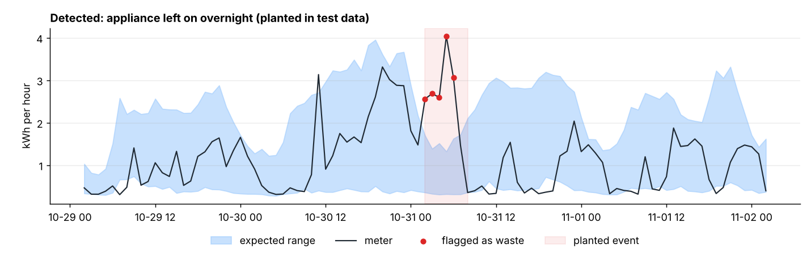
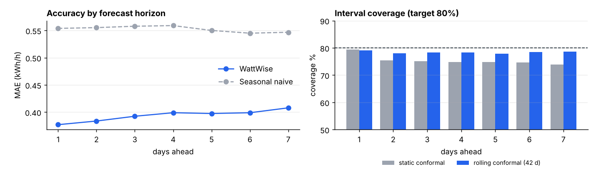
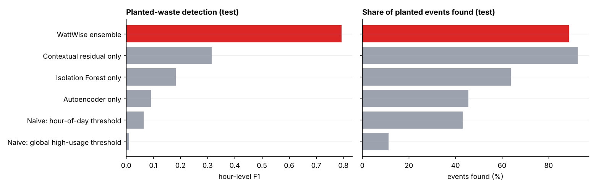

# ⚡ WattWise AI — Intelligent Electricity Waste Detection

WattWise reads smart-meter data and answers three questions:

1. **Is anything unusual?** It tells genuine waste apart from a home's normal daily variation. A busy evening is fine; the same usage at 3 am is not.
2. **How much could be saved?** It estimates avoidable kWh, cost and CO₂, attributes each event to a circuit, and gives concrete advice.
3. **What's coming next?** It forecasts the next 1–14 days hour by hour, with calibrated uncertainty bands.

Upload any meter CSV (or the raw Kaggle file) in the Streamlit app and get a waste report, a usage timeline, a demand forecast and a standby analysis.



---

## Quick start

```bash
pip install -r requirements.txt
streamlit run app.py          # opens http://localhost:8501 with a sample already analysed
```

Trained models are included. To rebuild everything, including the evaluation reports, run:

```bash
python train.py               # ~4 min on a laptop CPU; uses data/processed/hourly.parquet
python -m pytest tests/       # unit tests + headless test of the app on every sample
```

If loading the saved models fails because of a scikit-learn or LightGBM version mismatch, run `python train.py` once to rebuild them.

## Dataset

**Individual Household Electric Power Consumption** — UCI Machine Learning Repository, mirrored on Kaggle as
[`uciml/electric-power-consumption-data-set`](https://www.kaggle.com/datasets/uciml/electric-power-consumption-data-set).

- 2,075,259 one-minute readings from one house in Sceaux, near Paris, Dec 2006 – Nov 2010 (47 months)
- Total active/reactive power, voltage and current, plus **3 sub-meters**: kitchen (SM1), laundry room (SM2), and electric water heater + AC (SM3)
- About 1.25 % missing values

`data/processed/hourly.parquet` is the cleaned hourly version (34,589 hours) that `train.py` uses. To rebuild it from scratch, download `household_power_consumption.txt` from Kaggle into `data/raw/` and delete the parquet file.

## What makes it different (USP)

| Feature | Why it matters |
|---|---|
| **Context-aware waste vs normal variation** | Every hour is judged against what *this* home uses at *that* hour on *that* kind of day (hour × weekday/weekend robust statistics on forecast residuals), at 1 h, 3 h and 6 h scales. Each hour is labelled *Normal*, *High but normal variation*, *Unusual — likely waste*, *Elevated standby*, *Unusual — low* or *Data gap*. |
| **Three-detector ensemble** | Contextual residuals, an Isolation Forest and a neural day-profile autoencoder have to agree before a waste alert. Agreement cuts false alarms; the 6-hour evidence rule catches long, moderate waste such as an AC left on all afternoon. |
| **Standby-creep detector** | A day-level change detector on the nightly always-on floor. This is invisible hour by hour but costs money every hour of the year. |
| **Circuit-level root cause** | With sub-meters, each event's extra energy is split by circuit ("66 % laundry room"), and the cause and advice text follow from that. Without sub-meters, timing and duration rules are used instead. |
| **Avoidable-energy accounting** | Three non-overlapping buckets: anomalous excess (a conservative-to-expected range), standby above the home's own best nights in the same season, and peak-shifting savings under a time-of-use tariff. Results come with an efficiency grade from A to E. |
| **Calibrated probabilistic forecasts** | LightGBM quantile regression plus conformalized quantile regression per lead day, then **self-calibration on each uploaded meter's own recent errors** (rolling conformal). Daily totals get their own calibrated range, because hourly quantiles don't add up. |
| **Honest, labelled evaluation** | Real meters have no anomaly labels, so realistic waste events are planted into held-out data to measure recall and false alarms against naive alerts and each single detector. |
| **Works on any meter** | Auto-detects the timestamp, unit (kWh, Wh, kW, W), interval (1 min – 1 day) and circuit columns. The scale-normalised global model transfers between homes. Tariff, currency, CO₂ factor and holiday country are configurable (defaults: ₹8/kWh, 0.71 kg CO₂/kWh, India). |

## How it works

```
meter CSV ──► loader (unit/interval detection, hourly resampling, gap handling)
          ──► LightGBM quantile forecaster (P10/P50/P90, scale-normalised, no look-ahead)
                 └─ conformal calibration per lead day → expected range for every hour
          ──► anomaly ensemble
                 ├─ contextual residual z-scores (1/3/6 h, per hour × day-type, median/MAD)
                 ├─ Isolation Forest (context-normalised level, timing, circuit mix)
                 ├─ MLP autoencoder of 24-h profiles per circuit (per-hour reconstruction error)
                 └─ baseload change detector (nightly floor vs previous 14 days)
          ──► events → cause attribution → avoidable kWh / cost / CO₂ → recommendations
          ──► recursive 7-day forecast with calibrated hourly and daily bands
```

**Forecasting features** (all known at midnight before the forecast day; a unit test checks for leakage): same-hour lags (1, 2, 3, 7 and 14 days), same-hour 7-day mean and 4-week median, previous-day mean/max/min/std/last value, 7-day level, hour, weekday, holiday, and seasonal sin/cos terms. Targets are divided by a trailing 28-day scale so one model fits homes of any size.

**Alert thresholds** were tuned on the calibration period with planted waste (3 random seeds). The objective was to maximise events found plus F1 while staying within a budget of 1 false alarm per week.

## Results (held-out test period, Jul–Nov 2010)

Protocol: train Dec 2006 – Dec 2009, calibrate/tune Jan–Jun 2010, **test Jul–Nov 2010**. The test period was never used for any modelling choice.

### Day-ahead hourly forecast

| Model | MAE (kWh/h) | RMSE | WAPE |
|---|---|---|---|
| **WattWise LightGBM (quantile P50)** | **0.386** | **0.580** | **41.7 %** |
| Ridge regression (same features) | 0.432 | 0.589 | 46.6 % |
| Persistence (same hour yesterday) | 0.487 | 0.745 | 52.6 % |
| 4-week same-hour median | 0.492 | 0.699 | 53.1 % |
| Seasonal naive (same hour last week) | 0.553 | 0.806 | 60.3 % |

- **Daily totals:** WAPE 18.1 %, against 32.8 % for seasonal naive.
- **80 % interval, day ahead:** covers 79.3 % of hours.
- **Days 2–7:** coverage drops to 74–75 % with static calibration because of seasonal drift. Rolling conformal (last 42 days) restores it to **78–79 % at every lead day**; the app uses this approach.
- Single-home hourly load is inherently noisy (cooking and appliance timing), so a ~42 % hourly WAPE is typical. That's why the daily figures and the bands matter.



### Waste detection (planted events in test data, 5 seeds × 32 events)

| Detector (each tuned the same way) | F1 (hours) | Events found | False alarms / week |
|---|---|---|---|
| **WattWise ensemble** | **0.79** | **89 %** | 1.9 |
| Contextual residual only | 0.32 | 93 % | 4.5 |
| Isolation Forest only | 0.18 | 64 % | 1.5 |
| Autoencoder only | 0.09 | 46 % | 0.9 |
| Naive hour-of-day threshold | 0.06 | 43 % | 0.7 |
| Naive global "high usage" threshold | 0.01 | 11 % | 0.2 |

Events found by type for the ensemble: appliance left on overnight 97 %, standby creep 100 %, high-power spike 85 %, AC/heater running in an empty home 72 %.

"False alarms" are flags on hours where nothing was planted. Some of these are real anomalies in the original data, so precision (0.79) is a lower bound. The test-period false-alarm rate (1.9/week) is higher than on the calibration period (1.0/week); summer and autumn behaviour in this home is more irregular.



## Project structure

```
app.py                     Streamlit demo (upload → waste report, timeline, forecast, standby, model card, downloads)
train.py                   tuning, calibration, evaluation, figures, final models, demo files
wattwise/
  io.py                    loaders: Kaggle/UCI raw file and generic CSV (auto-detects units/interval/circuits)
  features.py              leakage-free, scale-normalised forecasting features
  forecast.py              LightGBM quantile forecaster, recursive multi-day, conformal + daily calibration
  anomaly.py               contextual residual, baseload-shift, Isolation Forest, autoencoder, ensemble labels
  injection.py             synthetic waste injection + evaluation metrics
  savings.py               events, circuit attribution, standby, peak shift, grade, recommendations
  pipeline.py              end-to-end analysis used by the app
models/                    trained forecaster + detectors (trained through Aug 2010)
reports/                   metrics.json and figures
data/sample/               demo files (Sep–Nov 2010, unseen by the shipped models)
tests/                     unit tests and a headless app test
```

## Demo files (`data/sample/`)

| File | Shows |
|---|---|
| `sample_meter_readings.csv` | Hourly kWh plus 3 circuits: the full experience, including circuit attribution |
| `sample_with_planted_waste.csv` | The same data with 8 planted waste events. The app shows which ones it found against `planted_waste_answer_key.csv` |
| `sample_total_only.csv` | Only timestamp + kWh, like most real smart meters |
| `sample_uci_minute_format.txt` | Raw Kaggle/UCI minute-level format, accepted as-is |

To use your own data, upload a CSV with a timestamp column and a consumption column in kWh, Wh, kW or W, at any interval. Optional `circuit_<name>` columns are treated as sub-meters. At least 14 days is required, and 6+ weeks is recommended so the app can learn your home's own normal pattern and self-calibrate.

## Limitations and next steps

- Trained on one French household. The scale-normalised model and per-meter self-calibration help it transfer, but a multi-home dataset such as London Smart Meters would make the forecaster more general.
- No weather input. Adding temperature would improve heating/cooling forecasts and explain weather-driven peaks.
- Planted events are realistic but synthetic. A small set of user-confirmed events could be used to fine-tune the thresholds.
- Peak-shift savings without sub-meters rely on an assumed movable share (adjustable in the app).
